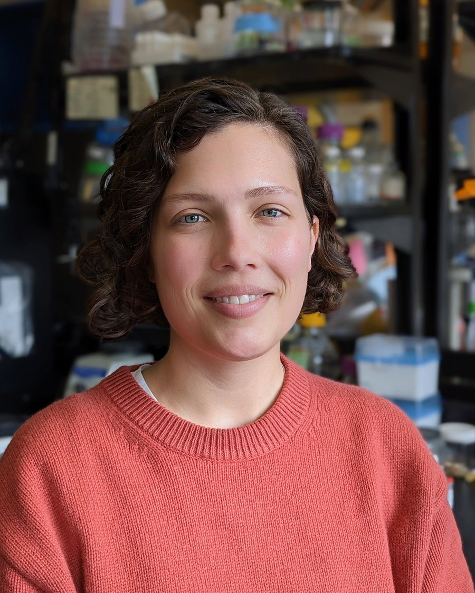

:::: {.about-frame}

```{=html}
<div class="about-head">
<div class="about-name h1" role="heading" aria-level="1">Katherine M. Kennedy</div>
<p class="about-links-plain">
  <a href="https://orcid.org/0000-0003-1240-9703">ORCID</a><span aria-hidden="true">·</span><a href="https://scholar.google.com/citations?user=rt7NtwEAAAAJ&amp;hl=en">Google Scholar</a><span aria-hidden="true">·</span><a href="https://www.linkedin.com/in/findkatekennedy/">LinkedIn</a><span aria-hidden="true">·</span><a href="https://github.com/kennek6">GitHub</a>
</p>
</div>
```

```{=html}

```

::: {.about-text}

::: {.standfirst}
The conditions a child starts life in, from the mother's diet and pregnancy history to the first
microbes the baby meets at birth, shape health for decades. I study how those conditions are set
and how the gut carries them forward, from infancy into aging. I'm a postdoctoral fellow in the
Department of Biochemistry and Biomedical Sciences at McMaster University.
:::

My first question was when that process begins. Using contamination-aware methods, I showed that
the gut is colonized at birth and not before. Since then I've followed what the mother passes on.
A first pregnancy changes the maternal gut microbiome differently than later ones, and in mice, a
maternal high-fat diet alters the fetal gut with effects that last into adulthood. The
[Research](research.qmd) page has the details.

Next, I want to follow that chain forward, from which early differences in the infant microbiome
track with growth and allergy in childhood to whether programming before birth changes how we
age. I work at the bench and the keyboard, from culturing and banking bacterial strains to shotgun
metagenomics and computational methods for tracking microbial communities over time. I lead the
Good Bugs Study, which tests whether specific vaginal microbes protect mothers and newborns from
Group B *Streptococcus*.

<!-- Personal line: Kate to write. -->

:::

```{=html}
<!-- Featured papers: hand-picked, oldest to newest. Edit this list directly. -->
<section class="featured" aria-labelledby="featured-label">
<p class="featured-label" id="featured-label">Featured papers</p>
<div class="paper-tiles">
  <a class="paper-tile" href="https://doi.org/10.1113/JP277353"><span class="paper-meta">J Physiol · 2019</span><span class="paper-title">High-fat diet intake modulates maternal intestinal adaptations to pregnancy and results in placental hypoxia, as well as altered fetal gut barrier proteins and immune markers</span></a>
  <a class="paper-tile" href="https://doi.org/10.1038/s41564-021-00904-0"><span class="paper-meta">Nature Microbiology · 2021</span><span class="paper-title">Fetal meconium does not have a detectable microbiota before birth</span></a>
  <a class="paper-tile" href="https://doi.org/10.1038/s41586-022-05546-8"><span class="paper-meta">Nature · 2023</span><span class="paper-title">Questioning the fetal microbiome illustrates pitfalls of low-biomass microbial studies</span></a>
  <a class="paper-tile" href="https://doi.org/10.1080/19490976.2023.2259316"><span class="paper-meta">Gut Microbes · 2023</span><span class="paper-title">Parity modulates impact of BMI and gestational weight gain on gut microbiota in human pregnancy</span></a>
  <a class="paper-tile" href="https://doi.org/10.1080/19490976.2026.2690907"><span class="paper-meta">Gut Microbes · 2026</span><span class="paper-title">Longitudinal modelling of microbiome subcommunities reveals parity-dependent dynamics during pregnancy and postpartum</span></a>
</div>
<p class="featured-more"><a href="publications.html">All publications</a></p>
</section>
```

::::
